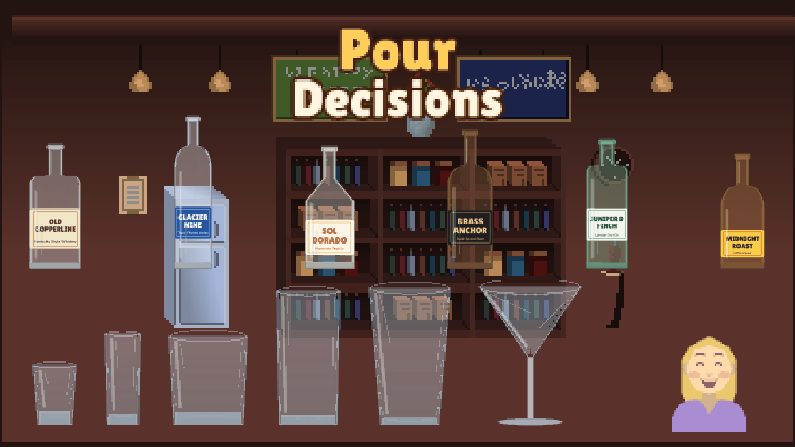

# Pour Decisions

A 2D pouring skill game made in Unity. A customer orders half a shot, one shot, a double; you tilt the bottle and pour **by eye** into glasses of very different shapes, then get graded on how close you got.



## Getting it running

The repo holds the game's `Assets/PourDecisions` folder plus tools and docs. It doesn't include Unity's generated `ProjectSettings/` or `Packages/`, so it works with whatever Unity version you have.

1. In Unity Hub, create a new project with the **2D (URP)** or **2D (Built-In Render Pipeline)** template. Unity 6 and 2022.3 LTS both work. Close Unity once the project exists.
2. Copy everything in this repo (including the hidden `.git` folder and `.gitignore`) into the new project's folder, next to its `Assets/`, `Packages/` and `ProjectSettings/` folders.
3. Open the project. The first time, it creates `Assets/Scenes/PourDecisions.unity` and adds it to Build Settings. If it doesn't, use **Pour Decisions > Create Game Scene** from the menu bar.
4. Press **Play**. Everything (camera, world, audio, UI) is built from code at runtime, so no scene setup or prefabs are needed.
5. Commit the new `ProjectSettings/` and `Packages/` folders so the repo becomes a complete project.

The code works with both the new Input System package and the old Input Manager. If sprites ever look stretched or blurry, run **Pour Decisions > Reimport Art**.

## Controls

| Action | Mouse (default) | Keyboard (hard mode, +25% points) |
|---|---|---|
| Tilt the bottle | Click and drag right (drag distance = tilt angle) | Hold Space, Right Arrow or D |
| Stop pouring | Let go | Let go |
| Serve | SERVE button | Enter or E |
| Pause | II button | Esc or P |
| Skip order (Training) | SKIP button | Tab |

The bottle lifts off the counter and keeps its spout over the glass on its own, so all you control is the angle.

## Modes

- **Classic**: five shifts that ramp up. You get more glass types, faster or messier spouts, thicker liquids, shorter timers, and in the last two shifts the lights go down. You need one star to unlock the next shift and can earn up to three.
- **Training**: no timer, a target line in the glass, and a live milliliter readout.

## What's interesting under the hood

- **Pour physics from bottle geometry** (`Core/PourMath.cs`). Each bottle's interior is a set of convex polygons. Every frame the game solves for the liquid surface inside the tilted bottle and measures how far the spout sits below it. That head drives a Torricelli-style flow model (square-root ramp, capped by the spout). So fuller bottles pour sooner, flow tapers as the bottle drains, and thick liquids need more tilt and respond slowly.
- **Real volumes** (`CupMath`). Glasses are truncated cones measured in centimeters (1 cm³ = 1 ml). The liquid mesh is drawn straight from that math, and the glass art is generated from the same numbers, so what you see is exactly what's scored.
- **Liquid in flight** (`Gameplay/PourStream.cs`). The bottle emits parcels of liquid that fly under gravity and only count once they land. If they hit the rim or miss the glass, they turn into spills and puddles.
- **Pour sound** (`Audio/AudioManager.cs`). The pour loop gets louder with how much liquid is landing and rises in pitch as the glass fills, which is your best cue in the dark levels.
- **Order generator** (`Gameplay/Orders.cs`). It only deals orders that fit in the glass and can be poured within the time limit.

## Project layout

```
Assets/PourDecisions/
  Scripts/
    Core/       Bootstrap + GameRoot (screens), PourMath (physics), Art loader, Settings, Input
    Gameplay/   ShiftController (order loop), TiltControl (mouse/keyboard tilt), Bottle, Glass,
                PourStream, Customer, Stage, Fx, Orders
    Audio/      AudioManager (SFX + pour loop)
    UI/         UIKit (widget helpers), Hud + HudWidgets (ticket, score board, bubble, grade popup,
                banners), Menus (title, level select, pause, results)
    Data/       GameData: every liquid, spout and level definition in one place for balancing
  Editor/       Art import settings, scene creation menu
  Resources/    Art (PNG), Audio (WAV), Fonts (TTF), Data/art_manifest.json
Tools/
  generate_art.py     Draws every sprite and writes art_manifest.json
  pixelate_art.py     Retro pass: chunky pixels, small palettes (run automatically by generate_art.py)
  compose_stock_art.py  Builds the bar background and counter from the CC0 Styloo pack in ThirdParty/
  generate_audio.py   Synthesizes every sound effect
  PhysicsTests/       Headless tests: game scripts compiled against tiny Unity stubs
CHANGES.txt           What changed from the design document and why
```

## Regenerating assets and running tests

```
pip install pillow numpy scipy
python3 Tools/generate_art.py      # also runs pixelate_art.py for the retro look
python3 Tools/generate_audio.py

# needs the .NET 8 SDK
dotnet run --project Tools/PhysicsTests
```

The tests check frustum volume round-trips, bottle start angles, pour times for every liquid and spout, that the stream lands in every glass for every bottle, fill level and tilt, that every level can deal a doable order, and the grading table.